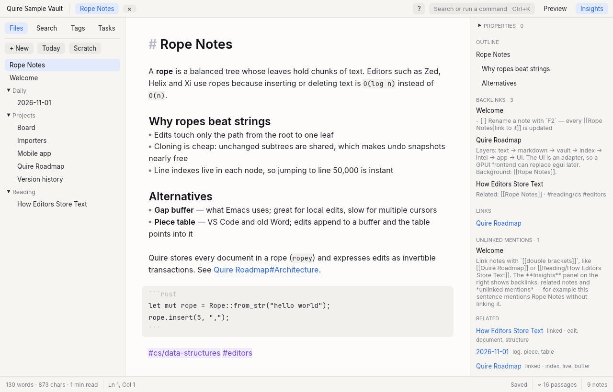
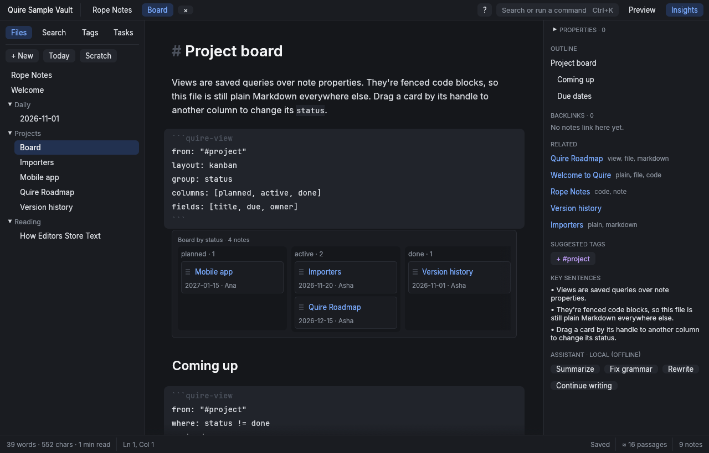
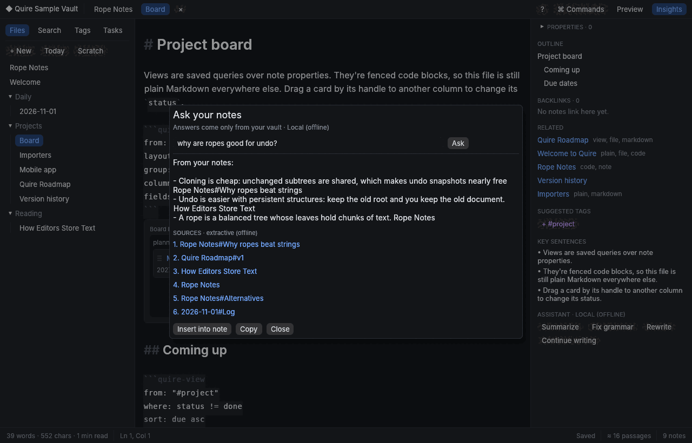
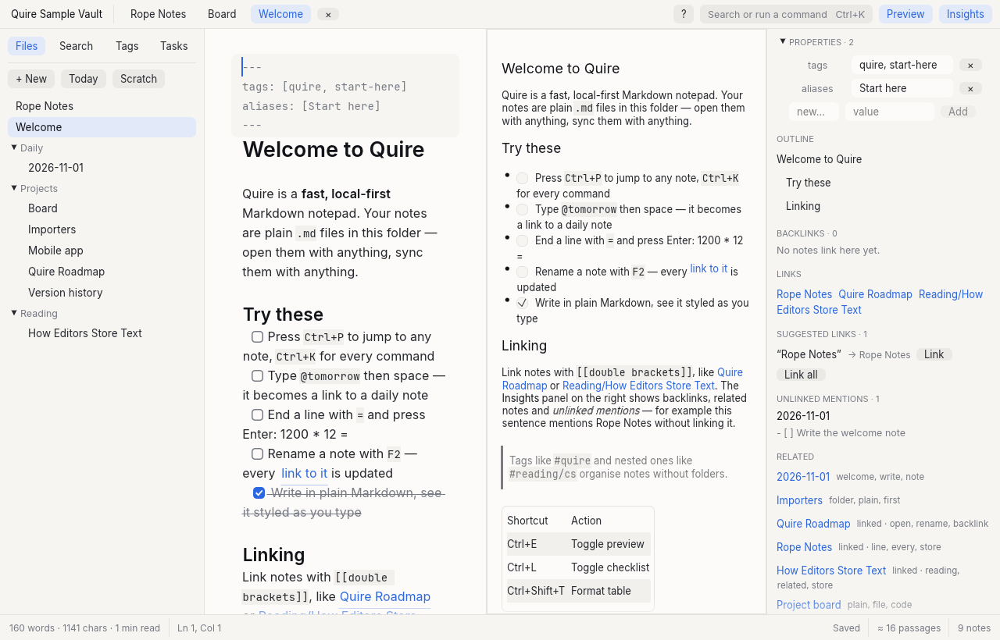
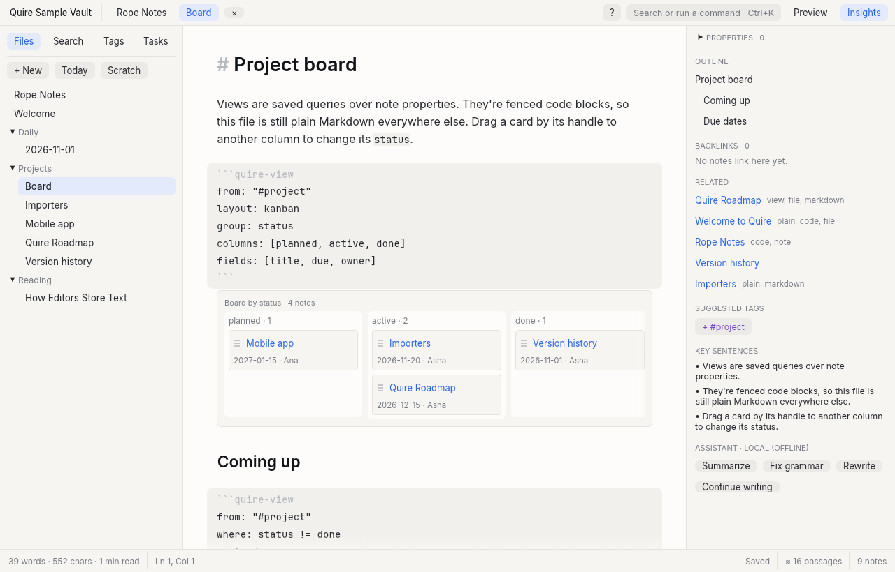

<p align="center"></p>

<h1 align="center">Quire</h1>

<p align="center">
A fast, local-first Markdown notepad in Rust.<br>
Plain <code>.md</code> files in a folder, styled as you type, linked like Obsidian, with on-device intelligence and no Electron.
</p>

<p align="center">
<a href="https://github.com/BhanuNexus/quire/actions/workflows/ci.yml"></a>
<a href="https://github.com/BhanuNexus/quire/releases"></a>
<a href="LICENSE"></a>
<a href="https://github.com/BhanuNexus/quire/discussions"></a>
</p>

<picture>
  <source media="(prefers-color-scheme: dark)" srcset="docs/screenshots/editor-dark.png">
  
</picture>

**Open source, all of it.** The app, the CLI, the importers and the future sync server are licensed under the [GNU AGPL v3 or later](LICENSE). Your notes are plain files you own. An optional, paid **managed sync** service will fund development later. You can always sync your folder with iCloud, Dropbox, Syncthing or Git instead, or run the sync server yourself.

[Install](#install) · [Features](#what-it-does) · [Roadmap](ROADMAP.md) · [Architecture](ARCHITECTURE.md) · [Contributing](CONTRIBUTING.md) · [Discussions](https://github.com/BhanuNexus/quire/discussions)

## Install

Download from [Releases](https://github.com/BhanuNexus/quire/releases). Each release comes in two editions:

| | **Quire** | **Quire Lite** |
|---|---|---|
| Editor, links, search, sync, graph, callouts, spelling, capture… | ✓ | ✓ |
| Math and Mermaid diagrams drawn in place | ✓ | shown as their source |
| Export as PDF | ✓ | — |
| App size | ~68 MB | ~28 MB |
| File names | `Quire-<version>-…` | `Quire-Lite-<version>-…` |

They're the same app working on the same files and settings. Installing one replaces the other, so you can switch either way at any time and your notes, settings and sync carry over. Settings → About says which one you have. Not sure which to take? Take **Quire**.


- **Windows 10/11:** `Quire-<version>-windows-x64-setup.exe` (no admin needed), or the portable zip.
- **macOS 11+:** `Quire-<version>-macos-universal.dmg` (Apple Silicon and Intel).
- **Linux x86_64:** pick one:
  - `Quire-<version>-linux-amd64.deb` for Debian and Ubuntu: `sudo apt install ./Quire-<version>-linux-amd64.deb`
  - `Quire-<version>-linux-x86_64.AppImage`: make it executable and run it (needs FUSE 2, or set `APPIMAGE_EXTRACT_AND_RUN=1`)
  - `Quire-<version>-linux-x86_64.tar.gz`: extract it and run `./install.sh` (no root needed)
- **Quire Lite:** the same files with `Quire-Lite-` in front (on Debian and Ubuntu the package is `quire-lite`, which replaces `quire` and the other way round).
- **Sync server (optional, Linux x86_64):** `quire-sync-server-<version>-linux-x86_64.tar.gz`, to [run your own Quire Sync](docs/self-hosting.md).

Until code signing is set up (planned for 1.0), your system will warn you the first time:

- **Windows:** SmartScreen says it protected your PC. Click *More info → Run anyway*.
- **macOS 15 and later:** macOS says it can't verify Quire. Click *Done*, open *System Settings → Privacy & Security*, scroll down and click *Open Anyway* next to Quire, then confirm. On macOS 14 and earlier, right-click the app and choose *Open* instead.

Every release file is built by GitHub Actions from a tagged commit, listed in `SHA256SUMS` and covered by a build-provenance attestation. You can verify a download:

```bash
sha256sum -c SHA256SUMS --ignore-missing
gh attestation verify Quire-<version>-linux-x86_64.tar.gz --repo BhanuNexus/quire
```

[RELEASING.md](RELEASING.md) explains how releases are built, attested and signed.

## Build and run

Builds with Rust 1.97.0, pinned in `rust-toolchain.toml` (rustup installs it automatically).

```bash
cargo run --release -p quire-desktop -- ./sample-vault      # desktop app
cargo run --release -p quire-cli -- index ./sample-vault    # headless tools
cargo test --workspace
```

Linux needs the usual X11/Wayland and OpenGL runtime libraries (`libxkbcommon`, `libGL`/Mesa).

Quire is **offline by default**. To use a model, open Settings (Ctrl+,) → *AI & search* and pick Ollama / LM Studio / any OpenAI-compatible server, or Anthropic. Keys go to the OS keychain (a 0600 file when no keychain exists), never the settings file.

Settings live in `~/.config/quire/settings.toml` (Linux), `~/Library/Application Support/dev.Quire.Quire/` (macOS) or `%APPDATA%\Quire\Quire\config\` (Windows).


**Quire Lite.** Math, Mermaid diagrams and PDF export use Typst, which is about 40 MB of the app. To build without them (they show as their Markdown source instead; everything else is the same), add `--no-default-features`:

```sh
cargo build --release -p quire-desktop --no-default-features   # ~28 MB instead of ~68 MB
```

## What it does

<table>
<tr>
<td></td>
<td></td>
<td></td>
</tr>
<tr>
<td align="center">Boards and views from note properties</td>
<td align="center">Ask your notes, with sources</td>
<td align="center">Live styling and preview</td>
</tr>
</table>

| Area | Features |
|---|---|
| AI agents, under review | Agents' edits to your notes arrive as suggestions shown in the note (struck-through lines, their version underneath) to accept, reject or edit change by change. The Inbox (Alt+I) collects them; Agent activity shows every run with "Revert run". Per-folder permissions, `AGENTS.md` approval, vault checks |
| Agent panel | Ctrl+Shift+J: ask about your notes or ask for changes, with `@note` and `#tag` context. Runs on your provider or on this computer; connect Claude Code or Codex (ACP) instead. "Ingest into wiki" turns a source into cited `wiki/` pages |
| On-device AI | Optional models that download once and run offline in a separate process: meaning search, writing help, the agent, OCR of images and scanned PDFs. Nothing downloads unless you ask |
| Answers you can check | Ask says "Not found" when your notes don't answer; cites exact sentences; Save as note keeps quotes as footnotes and flags them when the cited text changes. Staleness digest, contradictions (Preview), thinking timeline (Preview) |
| Planning | Tasks with dates, repeats and reminders (Obsidian Tasks emoji and Dataview fields), Agenda (Alt+A), Calendar, weekly/monthly/yearly notes, flashcards (FSRS, Ctrl+Alt+R), templates with questions |
| Canvas & drawing | `.canvas` files (JSON Canvas) with cards, connections and groups (Ctrl+Alt+C); pen, highlighter and shapes on a canvas or as a sketch in a note, saved as SVG |
| PDFs & citations | PDF viewer with highlights kept in a Markdown note (full edition; Lite shows the text). PDF pages are searchable ("paper.pdf p. 3"). `[@key]` citations from a BibTeX library, rendered in preview, HTML, websites and PDF export |
| Vim & themes | Vim keys (Normal, Insert, Visual, text objects, registers, `:s`), bundled and custom themes, a Git tab |
| Math & diagrams | `$x^2$`, `$$ … $$` and ```` ```mermaid ```` render in place (Typst + a pure-Rust Mermaid renderer, no browser), in the preview and in PDFs |
| Callouts & paragraph links | Obsidian callouts (`> [!tip] Title`) as coloured boxes everywhere; `[[Note#^id]]` links to a paragraph; Ctrl+Alt+L copies one |
| Spelling | Red underlines, suggestions on right-click, a personal dictionary; English built in, other Hunspell dictionaries picked up from your system |
| Quick capture | Ctrl+Alt+Space (⌘⇧Space) from any app adds a timestamped line to today's note; `quire-cli capture` too |
| PDF export | Ctrl+Alt+E or `quire-cli pdf`: a typeset PDF with callouts, code, tables, images, math and diagrams |
| Graph view | Your notes and links as a map, around the open note or the whole vault (Ctrl+G) |
| Split & fold | Two notes side by side (Ctrl+Alt+\\, or right-click → Open to the side), and fold any section under its heading |
| Editor | Fast virtualized editor: draws only visible lines, stays smooth on 10 MB / 100k-line files. Multiple cursors (Ctrl+D, Ctrl+Shift+L, Ctrl+Alt+↑/↓, Alt+click), word/line selection by double/triple click, IME input. Classic egui editor kept as a fallback |
| Writing | Live Markdown styling (heading sizes, bold, code, quotes, dimmed syntax), focus mode, preview pane, autosave with no save dialogs, scratchpad |
| Find & replace | In-note bar (Ctrl+F / Ctrl+H) with match case, whole word, regex and `$1` captures; vault-wide replace (Ctrl+Shift+R) with a per-note preview you can untick |
| Images & files | Paste a screenshot (Ctrl+V) or drop files: they're saved to `attachments/` and embedded; images show inline under the line and in the preview. Pasting a URL over selected text makes a link |
| Smart editing | Type `/` for a menu of headings, lists, checklists, code, tables, views, dates and your templates; `#` suggests tags you already use. List/task/quote continuation on Enter, Tab/Shift-Tab list indent, toggle checklist, wrap selection, heading levels, table auto-format |
| Inline intelligence | `12 * 4 =` + Enter → result (variables, `ans`, `%`, functions), `@tomorrow` / `@next friday` / `@in 3 days` → `[[2026-11-02]]` |
| Linking | Type `[[` for a list of notes to link (or a new one). `[[wikilinks]]`, `[[note#heading|alias]]`, embeds, click/Alt+Enter to follow, unresolved links create notes, F2 rename rewrites every link |
| Knowledge | Backlinks with context, unlinked mentions, suggested links, related notes (TF-IDF), suggested tags, key sentences, nested `#tags`, tasks across the vault |
| Finding | Ctrl+P fuzzy quick open, Ctrl+K command palette, search that combines exact words (BM25, `"phrases"`, `#tag`, `-exclude`) with meaning (≈ results); accents optional ("cafe" finds "Café") |
| Ask your notes | Ctrl+Shift+A: answers from your own notes with `[[Note#Heading]]` citations to the exact sentences. Offline it quotes the best sentences; with a provider or an on-device model it writes an answer from the same sources |
| Notes & folders | New notes take their name from the first line (until you rename them yourself). Right-click a note in the sidebar or a tab to rename, move to a folder, see version history, copy a `[[link]]`, show in folder or trash it. Double-click a tab to rename. Right-click a folder for "New note here" |
| Projects | **+ New → Project…** (Ctrl+Alt+N) creates `Projects/<name>.md` with status, due date and owner, and adds a project board (kanban + due-date table) the first time. Add `Templates/Project.md` to change what new projects contain |
| Publish | **Publish as a website** (command palette, or `quire-cli publish`): notes marked `publish: true` (or all of them) become a static site with links, backlinks, tags and search, ready for GitHub Pages, Netlify or any web server. Free, no account. Links to unpublished notes become plain text |
| Files | Daily notes, templates (`{{title}} {{date}} {{cursor}}`), atomic writes, soft delete to `.trash/`, outside-change detection, HTML export |
| Properties & views | Edit front matter in the Insights panel (types inferred: date, number, yes/no, list, text). ` ```quire-view ` blocks render live tables, lists, kanban boards (drag a card to change its field) and month calendars, and stay plain Markdown elsewhere |
| Version history | Every save keeps a compressed snapshot in `.quire/history/` (thinned to hourly/daily/weekly, max 200 per note). Ctrl+Alt+H shows versions with a diff; restore is undoable. Board moves, vault-wide replace and AI edits are versioned too |
| Import | Logseq graphs, Notion exports (.zip or folder, incl. database CSVs), Bear (.bear2bk / TextBundles), Evernote (.enex), any Markdown folder. Dry run first; never overwrites |
| AI providers | Offline by default. Optional OpenAI-compatible (Ollama, LM Studio, OpenAI) or Anthropic, streaming and with tools, with *Test connection*. Optional neural embeddings from the same kind of endpoint or on this computer, cached per passage, falling back to the built-in index |
| MCP server | `quire-cli mcp <vault>` (stdio) or over HTTP with OAuth: AI apps search by section, read line ranges, and edit precisely. Read-only unless started with `--allow-write`, which writes per the vault's agent policy (suggestions outside `wiki/`). See [docs/agents.md](docs/agents.md) |
| History | Undo tree: undo, type something else, and the old branch is still reachable |
| Quire Sync (beta) | Optional end-to-end encrypted sync, free through a folder you already sync (Dropbox, iCloud Drive, Google Drive, OneDrive, Syncthing), or through a server you run yourself ([guide](docs/self-hosting.md)). Only ciphertext leaves your device; concurrent edits merge line by line and never overwrite each other. A managed service is planned |
| Sync safety | Works with any folder sync (iCloud, Dropbox, Syncthing, Nextcloud, Git). A note changed elsewhere while you edit is merged line by line; overlapping edits pause autosave and let you keep yours, take theirs or keep both. Conflict copies made by sync tools are found and merged back |
| Updates | Optional daily check for a new release (Settings → About). Sends nothing about you; nothing installs itself |

## Keyboard

| Keys | Action | Keys | Action |
|---|---|---|---|
| Ctrl+P | Quick open | Ctrl+K | Command palette |
| Ctrl+N | New note | Alt+D | Today's note |
| Ctrl+Shift+F | Search | F2 | Rename (updates links) |
| Ctrl+E | Preview | F11 | Focus mode |
| Ctrl+B / I | Bold / italic | Ctrl+L | Toggle checklist |
| Ctrl+1–3 / 0 | Heading / paragraph | Ctrl+Shift+T | Format table |
| Ctrl+\\ | Insert `[[link]]` | Alt+Enter | Follow link |
| Ctrl+Enter | Evaluate math on line | Ctrl+Shift+E | Export HTML |
| Ctrl+F / Ctrl+H | Find / replace | Ctrl+Shift+R | Replace in all notes |
| Ctrl+D | Add next occurrence | Ctrl+Shift+L | Select all occurrences |
| Ctrl+Alt+↑/↓ | Add cursor above/below | Ctrl+Shift+A | Ask your notes |
| Ctrl+Alt+H | Version history | Ctrl+, | Settings |
| Ctrl+Alt+N | New project | F2 / double-click tab | Rename note |
| Ctrl+Alt+\\ | Split editor | Ctrl+Shift+[ | Fold/unfold section |
| Ctrl+G | Graph view | Ctrl+Alt+[ / ] | Fold / unfold all |
| Ctrl+Alt+E | Export as PDF | Ctrl+Alt+L | Copy link to paragraph |
| Ctrl+Alt+Space (⌘⇧Space) | Quick capture, from any app | Ctrl+Shift+J | Agent panel |
| Alt+I | Inbox | Alt+] / Alt+[ | Next / previous suggested change |
| Ctrl+Alt+Y | Accept suggested change | Ctrl+Alt+Backspace | Reject suggested change |
| Ctrl+Alt+Shift+Y | Accept all in this note | Alt+A | Agenda |
| Ctrl+Alt+R | Review flashcards | Ctrl+Alt+C | New canvas |

## Views



````markdown
```quire-view
from: "#project"            # tag, folder ("Projects/"), "./Sub/" (relative to this note) or all
where: status != done and due < 2026-12-01   # = != > < >= <= contains exists missing; "today" works
sort: due asc
layout: kanban              # table | list | kanban | calendar
group: status               # kanban columns (default: status)
columns: [planned, active, done]
fields: [title, due, owner] # front-matter fields plus title, folder, tags, tasks, open_tasks, words
date: due                   # calendar field
```
````

"Format: Insert view" adds a starter block. Clicking a title opens the note.

## Layout

```
crates/quire-text      rope buffer, transactions, undo tree, motions, multi-cursor edits (domain, no I/O)
crates/quire-markdown  highlight (whole or windowed), extract, front matter, render, smart edits
crates/quire-vault     Storage port, LocalFs/MemFs, notes, attachments, templates, rename refactor, watcher
crates/quire-index     BM25, fuzzy open, link graph, passages, semantic index, hybrid search, background actors
crates/quire-intel     related, mentions, tags, summary, calculator, dates, Ask, LLM port
crates/quire-import    Logseq, Notion, Bear, Evernote, Obsidian and Markdown importers, web capture
crates/quire-agent     the agent store: one write path, policy, proposals, provenance, ledger, Inbox
crates/quire-mcp       MCP server (stdio, HTTP + OAuth), tools, resources, prompts
crates/quire-assistant the agent loop, prompts, conversations, ACP bridge, ingest into wiki
crates/quire-ai        on-device models: catalog, downloads, the engine process (apps/quire-ai-engine)
crates/quire-plan      tasks, repeats, reminders, agenda, periodic notes, flashcards (FSRS)
crates/quire-canvas    JSON Canvas model, operations, node-level diff, ink
crates/quire-pdf       PDF text, find, highlight anchors, page rendering (full edition)
crates/quire-app       Document, Workspace, commands, find & replace, attachments, Ask, AI providers,
                       keychain, version history ops, properties & views (UI-agnostic)
apps/quire-desktop     egui frontend; view/ is the virtualized editor, view_ui renders quire-view blocks
apps/quire-cli         headless frontend, MCP server, importer, benchmark
```

## Command line

```bash
quire-cli search  ./sample-vault rope undo           # ≈ marks results found by meaning
quire-cli ask     ./sample-vault why do editors use ropes
quire-cli replace ./sample-vault "old" "new" --write # dry run without --write
quire-cli import  ~/Downloads/notion.zip ./vault --into Imported   # dry run; add --write
quire-cli history ./sample-vault "Quire Roadmap"     # saved versions of a note
quire-cli mcp     ./sample-vault                     # MCP server on stdio (read-only)
quire-cli agent   proposals ./sample-vault           # suggestions agents made, waiting for review
quire-cli ingest  ./sample-vault "Rope Notes"        # a source into cited wiki pages
quire-cli tasks   ./sample-vault --agenda            # overdue, today and the next seven days
quire-cli ai      models                             # on-device models and their state
quire-cli bench   10                                 # performance on a 10 MB note
```

To use Quire from Claude Desktop or another MCP client, add a server whose command is `quire-cli` with args `["mcp", "/path/to/vault"]`. Add `"--allow-write"` to let it edit: since 0.9 it writes directly only in agent folders (`wiki/`) and suggests changes everywhere else, for you to review in Quire. Settings → Connections has the setup for each app.

Set `QUIRE_TRACE=1` when launching the desktop app to print per-frame timings.

## Known limits

- **Built-in meaning search is a latent semantic index** learned from your own notes. It needs a few dozen notes before it helps much. For neural quality, download the on-device embedding model (Settings → AI) or point *Meaning search* at an embeddings endpoint (e.g. Ollama + `nomic-embed-text`).
- **On-device models need memory:** the balanced 1.7B chat model uses about 5 GB while answering (8 GB of RAM recommended for the small model, 16 GB for balanced), and generates a few tokens a second on a laptop CPU. Speed and memory were measured with models of the real shapes; check them on your computer. A build whose model list isn't pinned yet says "Not available in this build" and downloads nothing.
- **Contradictions and the thinking timeline are previews:** their thresholds come from the design, not from measurements on real vaults, and the prompts are English-first.
- The PDF viewer (pages, highlights, area selection) is in the full edition; Quire Lite shows a PDF's text and highlights and opens it in your system's viewer. OCR reads printed text best.
- An external agent connected to the agent panel runs with your permissions on your computer; only its writes through Quire are reviewed.
- On macOS, the Alt shortcuts (Alt+I, Alt+A, Alt+] and Alt+[) may type characters with some keyboard layouts; the commands are also in the palette (Ctrl+K).
- The fast editor reports itself to screen readers as a multi-line text field named after the note, with the caret's line as its value. It doesn't yet expose every visible line or the selection range. This and the inline IME pre-edit were checked in code and tests, not with a real screen reader or IME.
- Notes over 512 KB still edit and style fully, but outline, word count, insights and preview are turned off for them.
- egui has no complex-script shaping, so Devanagari and Arabic render but conjuncts may not join correctly.
- AI providers and the agent panel were tested against a local mock of the OpenAI-compatible API (chat, tools, streaming, models, embeddings), not against live Ollama or Anthropic servers.
- Importers were tested on synthetic exports that follow each app's documented format; run a dry run on your real export first.

## Contributing

Bug reports, imports from your real notes, docs and code are all welcome. Start with [CONTRIBUTING.md](CONTRIBUTING.md), then look for [`good first issue`](https://github.com/BhanuNexus/quire/labels/good%20first%20issue). Ideas and questions go in [Discussions](https://github.com/BhanuNexus/quire/discussions). Report vulnerabilities privately, as described in [SECURITY.md](SECURITY.md). Everyone taking part follows the [Code of Conduct](CODE_OF_CONDUCT.md).

## Licence

Copyright © 2026 The Quire contributors.

Quire is free software: you can redistribute it and/or modify it under the terms of the [GNU Affero General Public License](LICENSE), version 3 or (at your option) any later version. In short: you may use, study, change and share it. If you distribute it, or run a modified version as a network service, you must share the source under the same licence.

The app bundles:

- **Fonts:** the [Inter](https://rsms.me/inter/), [JetBrains Mono](https://www.jetbrains.com/lp/mono/) and [STIX Two Math](https://github.com/stipub/stixfonts) typefaces, under the [SIL Open Font License 1.1](apps/quire-desktop/fonts/Inter-OFL.txt).
- **Word lists:** the English word lists used for spell checking, from [SCOWL](http://wordlist.aspell.net/) by Kevin Atkinson. Their copyright and permission notices are in [`crates/quire-spell/dictionaries/`](crates/quire-spell/dictionaries/) and under **Settings → About → Third-party notices**.
