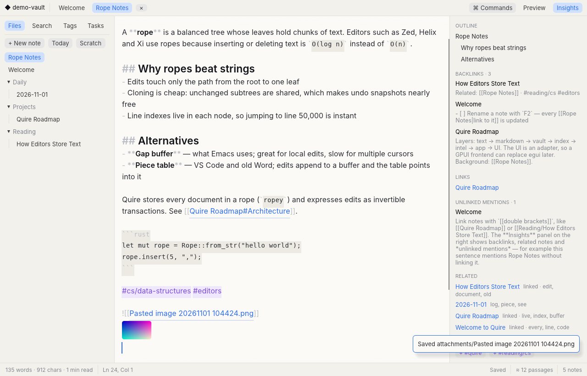
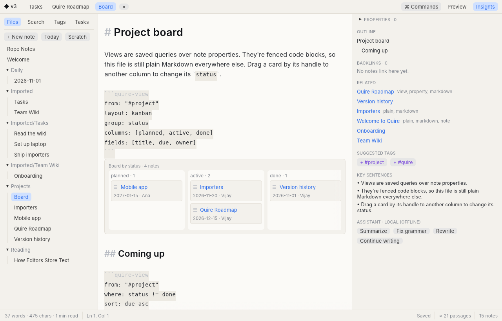

<p align="center"></p>

<h1 align="center">Quire</h1>

<p align="center">
A fast, local-first Markdown notepad in Rust.<br>
Plain <code>.md</code> files in a folder, styled as you type, linked like Obsidian, with on-device intelligence and no Electron.
</p>

<p align="center">
<a href="https://github.com/BhanuNexus/quire/actions/workflows/ci.yml"></a>
<a href="https://github.com/BhanuNexus/quire/releases"></a>
<a href="LICENSE"></a>
<a href="https://github.com/BhanuNexus/quire/discussions"></a>
</p>



**Open source, all of it.** The app, the CLI, the importers and the future sync server are licensed under the [GNU AGPL v3 or later](LICENSE). Your notes are plain files you own. An optional, paid **managed sync** service will fund development later. You can always sync your folder with iCloud, Dropbox, Syncthing or Git instead, or run the sync server yourself.

[Install](#install) · [Features](#what-it-does) · [Roadmap](ROADMAP.md) · [Architecture](ARCHITECTURE.md) · [Contributing](CONTRIBUTING.md) · [Discussions](https://github.com/BhanuNexus/quire/discussions)

## Install

Download from [Releases](https://github.com/BhanuNexus/quire/releases):

- **Windows 10/11:** `Quire-<version>-windows-x64-setup.exe` (no admin needed), or the portable zip.
- **macOS 11+:** `Quire-<version>-macos-universal.dmg` (Apple Silicon and Intel).

Until code signing is set up, Windows shows a SmartScreen prompt (*More info → Run anyway*). On macOS, right-click the app and choose *Open* the first time. [RELEASING.md](RELEASING.md) explains how releases are built and signed.

## Build and run

Builds with Rust 1.97.0, pinned in `rust-toolchain.toml` (rustup installs it automatically).

```bash
cargo run --release -p quire-desktop -- ./sample-vault      # desktop app
cargo run --release -p quire-cli -- index ./sample-vault    # headless tools
cargo test --workspace
```

Linux needs the usual X11/Wayland and OpenGL runtime libraries (`libxkbcommon`, `libGL`/Mesa).

Quire is **offline by default**. To use a model, open Settings (Ctrl+,) → *AI & search* and pick Ollama / LM Studio / any OpenAI-compatible server, or Anthropic. Keys go to the OS keychain (a 0600 file when no keychain exists), never the settings file.

Settings live in `~/.config/quire/settings.toml` (Linux), `~/Library/Application Support/dev.Quire.Quire/` (macOS) or `%APPDATA%\Quire\Quire\config\` (Windows).

## What it does

| Area | Features |
|---|---|
| Editor | Fast virtualized editor: draws only visible lines, stays smooth on 10 MB / 100k-line files. Multiple cursors (Ctrl+D, Ctrl+Shift+L, Ctrl+Alt+↑/↓, Alt+click), word/line selection by double/triple click, IME input. Classic egui editor kept as a fallback |
| Writing | Live Markdown styling (heading sizes, bold, code, quotes, dimmed syntax), focus mode, preview pane, autosave with no save dialogs, scratchpad |
| Find & replace | In-note bar (Ctrl+F / Ctrl+H) with match case, whole word, regex and `$1` captures; vault-wide replace (Ctrl+Shift+R) with a per-note preview you can untick |
| Images & files | Paste a screenshot (Ctrl+V) or drop files: they're saved to `attachments/` and embedded; images show inline under the line and in the preview. Pasting a URL over selected text makes a link |
| Smart editing | List/task/quote continuation on Enter, Tab/Shift-Tab list indent, toggle checklist, wrap selection, heading levels, table auto-format |
| Inline intelligence | `12 * 4 =` + Enter → result (variables, `ans`, `%`, functions), `@tomorrow` / `@next friday` / `@in 3 days` → `[[2026-11-02]]` |
| Linking | `[[wikilinks]]`, `[[note#heading|alias]]`, embeds, click/Alt+Enter to follow, unresolved links create notes, F2 rename rewrites every link |
| Knowledge | Backlinks with context, unlinked mentions, suggested links, related notes (TF-IDF), suggested tags, key sentences, nested `#tags`, tasks across the vault |
| Finding | Ctrl+P fuzzy quick open, Ctrl+K command palette, search that combines exact words (BM25, `"phrases"`, `#tag`, `-exclude`) with meaning (≈ results) |
| Ask your notes | Ctrl+Shift+A: answers from your own notes with `[[Note#Heading]]` citations. Offline it quotes the best sentences; with the optional Claude provider it writes an answer from the same sources |
| Notes & folders | New notes take their name from the first line (until you rename them yourself). Right-click a note in the sidebar or a tab to rename, move to a folder, see version history, copy a `[[link]]`, show in folder or trash it. Double-click a tab to rename. Right-click a folder for "New note here" |
| Projects | **+ New → Project…** (Ctrl+Alt+N) creates `Projects/<name>.md` with status, due date and owner, and adds a project board (kanban + due-date table) the first time. Add `Templates/Project.md` to change what new projects contain |
| Files | Daily notes, templates (`{{title}} {{date}} {{cursor}}`), atomic writes, soft delete to `.trash/`, outside-change detection, HTML export |
| Properties & views | Edit front matter in the Insights panel (types inferred: date, number, yes/no, list, text). ` ```quire-view ` blocks render live tables, lists, kanban boards (drag a card to change its field) and month calendars, and stay plain Markdown elsewhere |
| Version history | Every save keeps a compressed snapshot in `.quire/history/` (thinned to hourly/daily/weekly, max 200 per note). Ctrl+Alt+H shows versions with a diff; restore is undoable. Board moves, vault-wide replace and AI edits are versioned too |
| Import | Logseq graphs, Notion exports (.zip or folder, incl. database CSVs), Bear (.bear2bk / TextBundles), Evernote (.enex), any Markdown folder. Dry run first; never overwrites |
| AI providers | Offline by default. Optional OpenAI-compatible (Ollama, LM Studio, OpenAI) or Anthropic, with *Test connection*. Optional neural embeddings from the same kind of endpoint, cached per passage, falling back to the built-in index |
| MCP server | `quire-cli mcp <vault>` lets AI assistants search, read and ask your notes. Read-only unless started with `--allow-write`; every write is versioned |
| History | Undo tree: undo, type something else, and the old branch is still reachable |

## Keyboard

| Keys | Action | Keys | Action |
|---|---|---|---|
| Ctrl+P | Quick open | Ctrl+K | Command palette |
| Ctrl+N | New note | Alt+D | Today's note |
| Ctrl+Shift+F | Search | F2 | Rename (updates links) |
| Ctrl+E | Preview | F11 | Focus mode |
| Ctrl+B / I | Bold / italic | Ctrl+L | Toggle checklist |
| Ctrl+1–3 / 0 | Heading / paragraph | Ctrl+Shift+T | Format table |
| Ctrl+\\ | Insert `[[link]]` | Alt+Enter | Follow link |
| Ctrl+Enter | Evaluate math on line | Ctrl+Shift+E | Export HTML |
| Ctrl+F / Ctrl+H | Find / replace | Ctrl+Shift+R | Replace in all notes |
| Ctrl+D | Add next occurrence | Ctrl+Shift+L | Select all occurrences |
| Ctrl+Alt+↑/↓ | Add cursor above/below | Ctrl+Shift+A | Ask your notes |
| Ctrl+Alt+H | Version history | Ctrl+, | Settings |
| Ctrl+Alt+N | New project | F2 / double-click tab | Rename note |

## Views



````markdown
```quire-view
from: "#project"            # tag, folder ("Projects/"), "./Sub/" (relative to this note) or all
where: status != done and due < 2026-12-01   # = != > < >= <= contains exists missing; "today" works
sort: due asc
layout: kanban              # table | list | kanban | calendar
group: status               # kanban columns (default: status)
columns: [planned, active, done]
fields: [title, due, owner] # front-matter fields plus title, folder, tags, tasks, open_tasks, words
date: due                   # calendar field
```
````

"Format: Insert view" adds a starter block. Clicking a title opens the note.

## Layout

```
crates/quire-text      rope buffer, transactions, undo tree, motions, multi-cursor edits (domain, no I/O)
crates/quire-markdown  highlight (whole or windowed), extract, front matter, render, smart edits
crates/quire-vault     Storage port, LocalFs/MemFs, notes, attachments, templates, rename refactor, watcher
crates/quire-index     BM25, fuzzy open, link graph, passages, semantic index, hybrid search, background actors
crates/quire-intel     related, mentions, tags, summary, calculator, dates, Ask, LLM port
crates/quire-import    Logseq, Notion, Bear, Evernote and Markdown importers (plan → apply)
crates/quire-app       Document, Workspace, commands, find & replace, attachments, Ask, AI providers,
                       keychain, version history ops, properties & views (UI-agnostic)
apps/quire-desktop     egui frontend; view/ is the virtualized editor, view_ui renders quire-view blocks
apps/quire-cli         headless frontend, MCP server, importer, benchmark
```

## Command line

```bash
quire-cli search  ./sample-vault rope undo           # ≈ marks results found by meaning
quire-cli ask     ./sample-vault why do editors use ropes
quire-cli replace ./sample-vault "old" "new" --write # dry run without --write
quire-cli import  ~/Downloads/notion.zip ./vault --into Imported   # dry run; add --write
quire-cli history ./sample-vault "Quire Roadmap"     # saved versions of a note
quire-cli mcp     ./sample-vault                     # MCP server on stdio (read-only)
quire-cli bench   10                                 # performance on a 10 MB note
```

To use Quire from Claude Desktop or another MCP client, add a server whose command is `quire-cli` with args `["mcp", "/path/to/vault"]`. Add `"--allow-write"` to let it create and append to notes.

Set `QUIRE_TRACE=1` when launching the desktop app to print per-frame timings.

## Known limits

- **Built-in meaning search is a latent semantic index** learned from your own notes. It needs a few dozen notes before it helps much. For neural quality, point *Meaning search* at an embeddings endpoint (e.g. Ollama + `nomic-embed-text`); an in-process model is not bundled.
- The fast editor reports itself to screen readers as a multi-line text field named after the note, with the caret's line as its value. It doesn't yet expose every visible line or the selection range. This and the inline IME pre-edit were checked in code and tests, not with a real screen reader or IME.
- Notes over 512 KB still edit and style fully, but outline, word count, insights and preview are turned off for them.
- egui has no complex-script shaping, so Devanagari and Arabic render but conjuncts may not join correctly.
- AI providers were tested against a local mock of the OpenAI-compatible API (chat, models, embeddings), not against live Ollama or Anthropic servers.
- Importers were tested on synthetic exports that follow each app's documented format; run a dry run on your real export first.

## Contributing

Bug reports, imports from your real notes, docs and code are all welcome. Start with [CONTRIBUTING.md](CONTRIBUTING.md), then look for [`good first issue`](https://github.com/BhanuNexus/quire/labels/good%20first%20issue). Ideas and questions go in [Discussions](https://github.com/BhanuNexus/quire/discussions). Report vulnerabilities privately, as described in [SECURITY.md](SECURITY.md). Everyone taking part follows the [Code of Conduct](CODE_OF_CONDUCT.md).

## Licence

Copyright © 2026 The Quire contributors.

Quire is free software: you can redistribute it and/or modify it under the terms of the [GNU Affero General Public License](LICENSE), version 3 or (at your option) any later version. In short: you may use, study, change and share it. If you distribute it, or run a modified version as a network service, you must share the source under the same licence.

