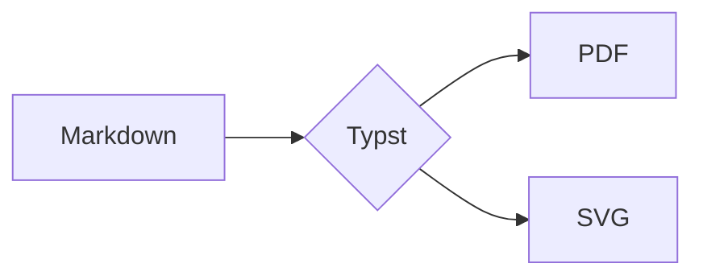

Quire turns a note into a PDF with **real typography**: *italics*, **bold**,
~~strikethrough~~, `inline code`, [links](https://example.com/docs) and
[[Wikilinks]] or [[Some Note|aliased wikilinks]].

## Mathematics

Inline math sits on the line: $e^{i\pi} + 1 = 0$, and so does
$\sqrt{a^2 + b^2}$ or $\mathbb{R}^n$. Display math gets its own block:

$$
\int_0^\infty e^{-x^2}\,dx = \frac{\sqrt{\pi}}{2}
\qquad
\sum_{k=1}^{n} k = \frac{n(n+1)}{2}
$$

$$
\begin{aligned}
  \nabla \cdot \mathbf{E} &= \frac{\rho}{\varepsilon_0} \\
  \nabla \times \mathbf{B} &= \mu_0 \mathbf{J} + \mu_0 \varepsilon_0 \frac{\partial \mathbf{E}}{\partial t}
\end{aligned}
$$

A matrix: $A = \begin{pmatrix} 1 & 2 \\ 3 & 4 \end{pmatrix}$, and a broken
formula shows its source: $\frac{1}{\undefinedcommand}$.

## Callouts

> [!note] Good to know
> Callouts keep their colour and title. They can hold **formatting**,
> lists and `code`:
> - one
> - two

> [!warning]
> Without a title, the type is the title.

> [!tip] Tip with a formula
> The golden ratio is $\varphi = \frac{1 + \sqrt 5}{2}$.

> [!mystery] Unknown types
> get a neutral style.

> A plain block quote, for contrast.
> It spans two lines.

## Lists

1. First
2. Second
   - nested bullet
   - another, with *emphasis*
     1. deeply nested
3. Third

- [ ] An open task
- [x] A finished task
- A plain item among tasks
- [ ] A task with `code`
  - [x] and a nested one

## Code

```rust
fn main() {
    // Syntax highlighting comes from Typst.
    let greeting = "Hello, #world $x$ [brackets]";
    println!("{greeting}");
}
```

## Table

| Feature  | Status | Notes                 |
|:---------|:------:|----------------------:|
| Math     | done   | via MiTeX             |
| Diagrams | done   | mermaid-rs-renderer   |
| Images   | done   | PNG, JPEG, SVG, WebP  |

## Diagram



## Images


![[missing-picture.png]]

---

That's all. Footnotes work too[^1], and can be reused[^1].

[^1]: A footnote with *formatting* and math $x^2$.
